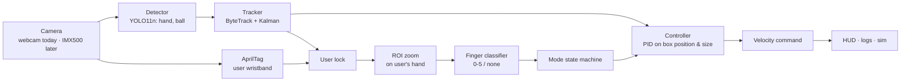

# Gesture Drone Vision

**The brain of a hand-gesture-controlled drone, built and benchmarked before the drone exists.**
Hold up fingers and the drone follows you, tracks a ball, hovers, or lands. It ignores
everyone except the person wearing the marker.

<!-- Hero GIF (M8): simulated drone flying from live webcam gestures, camera view side by side. -->
> 🎬 *Demo GIF coming: the camera view (boxes, finger count, mode HUD) next to a simulated
> drone flying from those commands.*

---

## What it does

| | Capability | Status |
|---|---|---|
| 🖐️ | **Custom detector** (YOLO11n) finds hands and a ball in every frame | dataset built |
| ✌️ | **Finger-count classifier** reads 0–5 from a zoomed-in hand crop | dataset built |
| 🎯 | **Tracking**: stable IDs for hands; Kalman-filtered ball path through blur and misses | planned |
| 🔒 | **Single-user lock**: only the hand next to the user's AprilTag wristband gives commands | planned |
| 🧠 | **Mode state machine**: a count held ~0.7 s switches mode; *land* always wins | planned |
| 🕹️ | **Control output**: each mode emits a velocity command (vx, vy, vz, yaw), drawn as an arrow | planned |
| 📊 | **Benchmarks**: FPS, per-stage latency, FP32 vs INT8, CPU vs GPU, accuracy vs distance | planned |
| 🔋 | **Power budget**: measured energy per frame plus a modelled flight-time estimate | planned |
| 🛩️ | **Simulation**: 2D sim, then ArduPilot SITL, flown from webcam gestures | stretch |

| Fingers | Mode |
|:---:|---|
| 5 | follow my hand |
| 4 | **land** (overrides everything) |
| 3 | track the ball |
| 2 | hover |
| 1 | TBD |

## How it works

**Why two models?** At 4 m a hand is only about 20 px wide in a 640 px frame (a geometry
estimate), far too small to count fingers. So the detector finds the hand in the full frame,
and the classifier reads the fingers from a high-resolution crop. On the drone's Sony IMX500
AI camera, that crop becomes the sensor's region-of-interest setting.

## From laptop to drone

| On the laptop (now) | On the drone (later) |
|---|---|
| Webcam through a pluggable `FrameSource` | Raspberry Pi 5 + IMX500 AI camera (same interface) |
| ONNX Runtime on CPU (headline timings) | INT8 model on the IMX500 / Pi 5 CPU |
| Full-resolution crop around the hand | IMX500 ROI readout |
| Velocity arrow on screen | MAVLink velocity commands to the flight controller |
| Keyboard "glove simulator" | Touch-contact glove over radio |

## Results

Every number here is generated by a script in this repo and labelled with the device it ran
on. Nothing is hand-entered.

- **Datasets** → [results/dataset_summary.md](results/dataset_summary.md): images, boxes and
  crops per split and class.
- Detector accuracy, latency, energy per frame and the accuracy-vs-distance chart arrive with
  milestones M2–M7.

Dev machine: ASUS ROG Zephyrus G14 (Ryzen 9 7940HS, RTX 4060 Laptop 8 GB). Laptop numbers are
not Pi numbers. Embedded estimates are marked as proxies.

## Progress

- [x] **M0** Setup: package, CI, environment check, webcam demo
- [ ] **M1** Datasets: HaGRIDv2 subset + COCO balls + own clips
- [ ] **M2** Hand/ball detector
- [ ] **M3** Finger-count classifier
- [ ] **M4** Tracking, user lock, ROI zoom
- [ ] **M5** Modes + control commands
- [ ] **M6** Benchmarks
- [ ] **M7** Power & battery estimate
- [ ] **M8** Demo GIFs
- [ ] **M9** Simulation (stretch)

Full plan: [PLAN.md](PLAN.md).

## Built with

PyTorch · Ultralytics YOLO11 · ONNX Runtime · OpenCV · pupil-apriltags · NVML · pytest/ruff ·
GitHub Actions

## Credits

- **HaGRIDv2**: Kapitanov et al., *HaGRID: HAnd Gesture Recognition Image Dataset* (WACV 2024);
  Nuzhdin et al., *HaGRIDv2* (arXiv:2412.01508). Licensed under a variant of CC BY-SA 4.0.
- **COCO 2017** (`sports ball`): annotations CC BY 4.0; images under their Flickr licenses.

---

Want to run it yourself? See [docs/SETUP.md](docs/SETUP.md).
