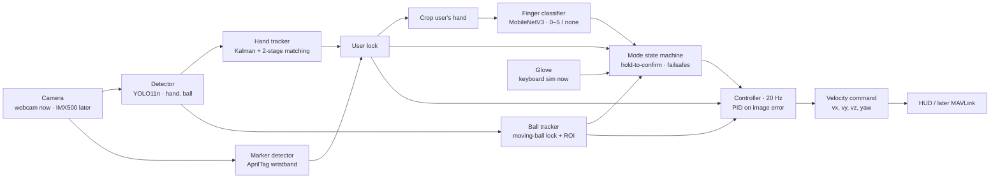

# Gesture Drone Vision

**The vision and control "brain" of a gesture-controlled drone, built and tested on a laptop
webcam before any drone hardware exists.**

<!-- Hero GIF goes here: docs/media/demo.gif (camera view with HUD next to a simulated drone). -->
> 🎬 *Demo GIF coming soon: the camera view (user lock, finger count, mode panel, velocity
> command) next to a simulated drone flying from those commands.*

---

## What it does

Hold up fingers and the drone follows you, tracks the ball, hovers or lands. It only listens
to the person wearing the wristband marker.

| Fingers (held 0.7 s) | Mode |
|:---:|---|
| 5 | **follow hand**: keep the user's hand centred at a set distance |
| 3 | **track ball**: lock onto the one moving ball in play (soccer) |
| 2 | **hover** |
| 4 | **land**: always wins and stays latched |

- **User lock.** An AprilTag on the wrist is only needed to *acquire* the user. After that the
  lock follows that hand's track ID through motion blur and missed detections, and every other
  hand is ignored. The marker is pluggable: a colour-patch/LED version for the glove's wrist
  pod can replace the AprilTag.
- **Ball tracking.** A single-target tracker built for a match: it acquires only a ball that
  has been seen several times *and is moving*, so lamps, round signs and a spare ball on the
  sideline are learned as static spots and ignored. Once locked, it holds through missed
  frames, and each frame it predicts a crop window (ROI) for the next one.
- **Glove + vision.** A touch-contact glove (simulated with the keyboard for now) is the
  primary command channel and acts immediately. Finger counting is the hands-free fallback.
- **Failsafes.**
  - User lost: hover after 2 s, land after 10 s.
  - Glove radio link lost: hover after 1 s, land after 5 s, in every mode.
  - Ball lost: hover after 3 s.

  All timings are in `configs/modes.yaml`.
- **Control output.** A fixed 20 Hz control loop, separate from the camera loop, turns the
  target's position and size in the image into a velocity command (vx, vy, vz, yaw rate) with
  per-axis PID, clamps and slew limits. The HUD draws it as an arrow, a yaw arc and a
  climb bar.

## How it works



**Why two models?** At a few metres a hand is only a few dozen pixels wide in the frame, too
small to count fingers reliably. The detector finds the hand in the full frame, and the
classifier reads the fingers from a full-resolution crop. On the IMX500 that crop becomes the
sensor's region-of-interest readout.

## Results

Every number below was produced by a script in this repo, on the device named. Laptop numbers
are not Raspberry Pi numbers.

**Models** (test split = HaGRIDv2 test + COCO val2017 balls; no own-recorded clips yet)

| Model | Metric | Value | Source |
|---|---|---|---|
| Detector, YOLO11n @ 320 px, FP32 | test mAP50 (hand / ball) | 0.637 (0.994 / 0.280) | [quantization.md](results/detector/y11n_320_baseline/quantization.md) |
| Detector, INT8 for IMX500 (314 calibration images) | test mAP50 (hand / ball) | 0.555 (0.982 / 0.127) | same |
| Detector, INT8 for IMX500 | on-chip memory | 3.76 MB, 48 % of 8 MB, fits | same |
| Finger classifier, MobileNetV3-Small @ 128 px | test accuracy (ONNX, 7 classes) | 0.987 | [train_summary.json](results/classifier/mnv3s_128_baseline/train_summary.json) |
| Finger classifier | latency per crop (ONNX Runtime, Ryzen 9 7940HS CPU) | 0.6 ms median | same |

Training ran on an RTX 4060 Laptop GPU: the detector took 50 epochs in 22.8 min, the
classifier 6.8 min. Quantising for the IMX500 keeps hands almost unchanged but cuts ball
mAP50 by more than half, so the ball tracker is designed to tolerate a low per-frame hit rate.

**Live pipeline**: `run_demo.py --control` on an ASUS ROG Zephyrus G14 (Ryzen 9 7940HS),
ONNX Runtime on CPU, 640×480 webcam:

| Stage | Mean per frame |
|---|---|
| Detector (pre + inference + post) | 9.2 ms (p95 10.1 ms) |
| Hand tracker | 0.1 ms |
| AprilTag search (only until the user is locked) | 8.8 ms |
| Whole loop | 30.0 FPS (camera-limited) |
| Control loop | 20.1 Hz, 0 late ticks |

More: [dataset summary](results/dataset_summary.md),
[detector curves](results/detector/y11n_320_baseline/),
[classifier confusion matrix](results/classifier/mnv3s_128_baseline/confusion_matrix_test.png).

**Known limits (so far)**
- Ball accuracy is the weak spot. COCO balls are mostly close-up. On real match footage the
  lock holds when the ball is clearly visible but drops it during fast camera pans. On a high,
  straight-down view it fails, because the ball is only a few pixels and the model has never
  seen aerial images.
- A sideways hand at around 3 m is hard to count from a 640×480 webcam. The ROI crop on the
  real camera is meant to fix this.

## From laptop to drone

| On the laptop (now) | On the drone (planned) |
|---|---|
| Webcam behind a pluggable `FrameSource` | Raspberry Pi 5 + Sony IMX500 camera module (same interface) |
| ONNX Runtime on the laptop CPU | INT8 detector on the IMX500, classifier on the Pi 5 CPU |
| Full-resolution crop around the hand / ball | IMX500 region-of-interest readout |
| Keyboard glove simulator + simulated heartbeat | Touch-contact glove over radio, link-loss failsafe |
| AprilTag on cardboard | Colour patch / LED on the glove's wrist pod |
| Velocity command drawn on the HUD | MAVLink velocity commands to the flight controller |

## Try it

```powershell
pip install -e ".[cpu,dev]"                       # GPU / training setup: docs/SETUP.md
python scripts/run_demo.py --source 0 --control   # needs the trained ONNX models
pytest
```

Print the wristband tag from [docs/markers/](docs/markers/). The full setup, keys and training
steps are in [docs/SETUP.md](docs/SETUP.md).

## Roadmap

- [x] Hand/ball detector, finger classifier, IMX500 export + INT8 check
- [x] Hand tracking, user lock, ball tracker with ROI
- [x] Mode state machine, failsafes, 20 Hz controller, HUD
- [ ] Ball accuracy: elevated/aerial soccer data, camera-motion compensation, detector inside
  the ROI crop
- [ ] Benchmarks: per-stage latency, CPU vs GPU, FP32 vs INT8, accuracy vs distance
- [ ] Power: measured energy per frame and a modelled flight-time budget
- [ ] Demo GIFs
- [ ] Simulation: 2D top-down sim, then ArduPilot SITL over MAVLink
- [ ] Hardware: Pi 5 + IMX500 port, glove prototype

## Credits and licenses

- **Code:** MIT, see [LICENSE](LICENSE).
- **HaGRIDv2:** Kapitanov et al., *HaGRID: HAnd Gesture Recognition Image Dataset* (WACV
  2024); Nuzhdin et al., *HaGRIDv2* (arXiv:2412.01508). Licensed under a variant of
  CC BY-SA 4.0.
- **COCO 2017** (`sports ball`): annotations CC BY 4.0; images under their Flickr licenses.
- **Ultralytics YOLO11** (training and export) is AGPL-3.0; models trained with it fall under
  its license terms.
- **MobileNetV3-Small** ImageNet weights via torchvision; **AprilTag 3** via pupil-apriltags.
- Real-footage tests used free stock clips from Mixkit (Mixkit License). They are not
  redistributed here.

Datasets, weights and recordings are not part of this repo. The scripts download or rebuild
them.

<sub>Built with PyTorch · Ultralytics · ONNX Runtime · OpenCV · pupil-apriltags · pytest ·
ruff · GitHub Actions</sub>
