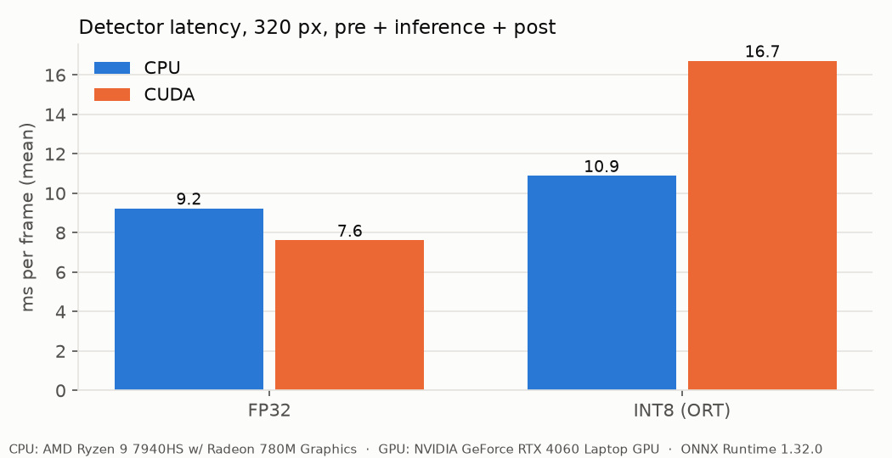

# Detector benchmarks

Generated by `scripts/benchmark.py` on 2026-11-17. CPU: **AMD Ryzen 9 7940HS w/ Radeon 780M Graphics**; GPU: **NVIDIA GeForce RTX 4060 Laptop GPU**; ONNX Runtime 1.32.0; YOLO11n at 320 px; 200 val images, 30 warm-up + 300 timed frames per configuration, interleaved over 5 rounds.

INT8 (ORT) is the same model statically quantized by ONNX Runtime (QDQ, convolutions only, calibrated on val images). It is a laptop INT8, not the IMX500's.

| model | provider | size (MB) | inference mean / p95 (ms) | total mean / p95 (ms) |
|---|---|---:|---:|---:|
| FP32 | CPU | 10.05 | 7.73 / 8.44 | 9.23 / 10.1 |
| FP32 | CUDA | 10.05 | 6.27 / 7.27 | 7.61 / 8.75 |
| INT8 (ORT) | CPU | 2.89 | 9.39 / 10.16 | 10.88 / 11.87 |
| INT8 (ORT) | CUDA | 2.89 | 15.29 / 17.2 | 16.71 / 18.76 |

Total = letterbox + inference + decode/NMS, as in the live demo.

Total time per frame, ratio (< 1 = faster):

- FP32: CUDA vs CPU: 0.82x (9.23 -> 7.61 ms)
- CPU: INT8 (ORT) vs FP32: 1.18x (9.23 -> 10.88 ms)
- CUDA: INT8 (ORT) vs FP32: 2.20x (7.61 -> 16.71 ms)

## Accuracy (test split, mAP50)

| model | mAP50 | hand | ball |
|---|---:|---:|---:|
| FP32 | 0.6395 | 0.9926 | 0.2864 |
| INT8 (ORT) | 0.638 | 0.9915 | 0.2845 |

IMX500 INT8 accuracy (MCT, CPU emulation): see [quantization.md](detector/y11n_320_baseline/quantization.md).
